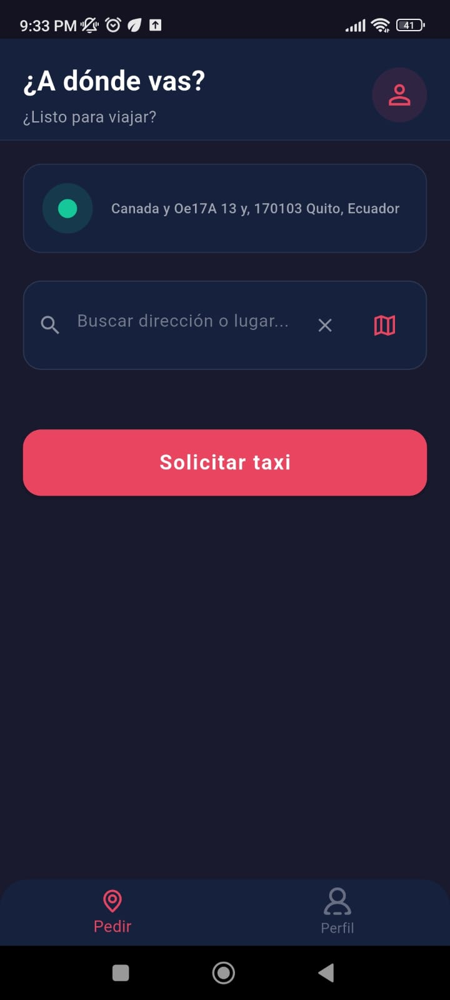
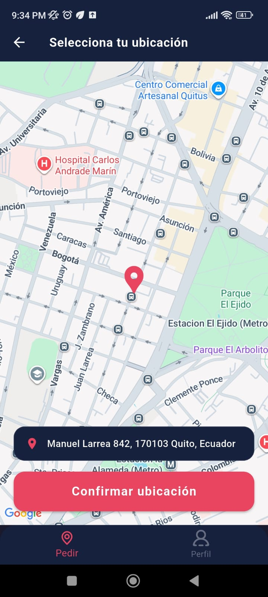
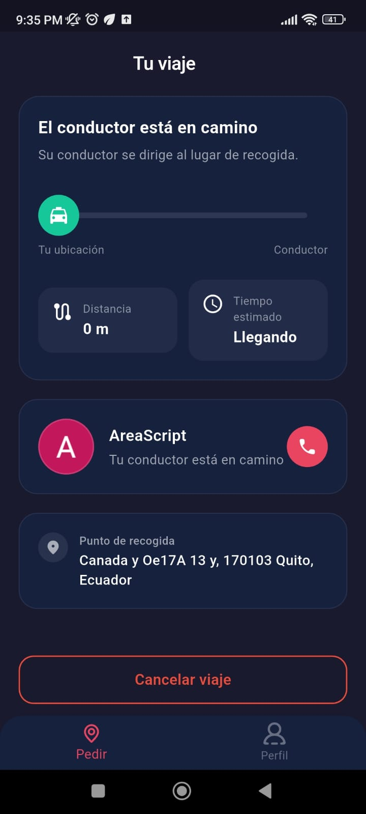
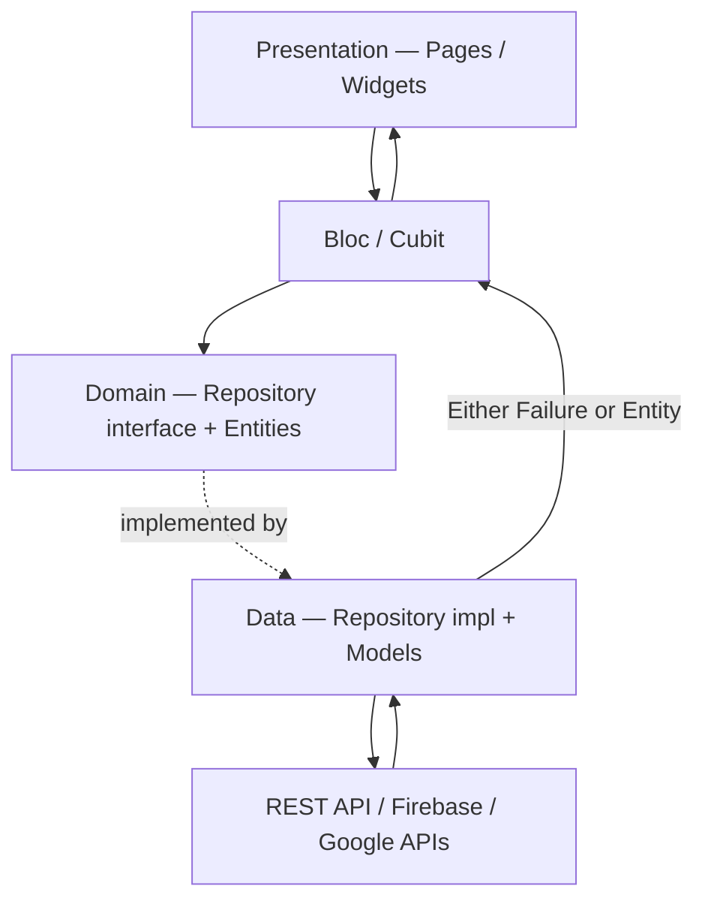
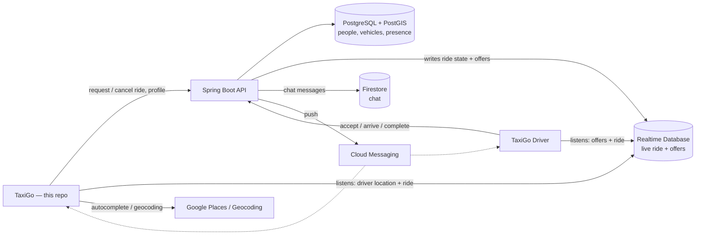

<div align="center">


# TaxiGo

**The passenger-side app of TaxiGo — a real-time taxi-hailing platform built for the city of Riobamba, Ecuador.**

[](https://flutter.dev)
[](https://dart.dev)
[](https://firebase.google.com)
[]()
[]()
[](https://github.com/areascript22/project-taxi-passenger/actions/workflows/deploy_qa.yml)
[](https://github.com/areascript22/project-taxi-passenger/actions/workflows/deploy_prod.yml)
[]()

[Overview](#-overview) • [Screenshots](#-screenshots) • [Features](#-key-features) • [Architecture](#-architecture) • [Tech Stack](#-tech-stack) • [Testing](#-testing) • [CI/CD](#-cicd) • [Getting Started](#-getting-started)

</div>

---

## 📖 Overview

**TaxiGo** is the rider-facing half of a two-sided, real-time taxi-hailing system made of three pieces:

| Piece | Repository | Role |
|---|---|---|
| **TaxiGo** (this repo) | `project-taxi-passenger` | Riders request a taxi and follow it live |
| **TaxiGo Driver** | [`project-taxi-driver`](https://github.com/areascript22/project-taxi-driver) | Drivers receive offers and run the trip |
| **TaxiGo backend** | `taxi-backend` (private) | Spring Boot API + PostgreSQL/PostGIS. Source of truth for people, dispatch and the ride lifecycle |

Beyond "request a ride", the app handles the messy realities of a real dispatch product: **resuming a ride after the app was killed and reopened from a push notification**, **debounced address autocomplete**, **a coverage check against the city's sectors**, **live driver tracking with distance/ETA**, and **graceful timeouts** when no driver is available.

## 📱 Screenshots

<table>
<tr>
<td align="center"><br/><sub><b>Request a taxi</b></sub></td>
<td align="center"><br/><sub><b>Pick a location on the map</b></sub></td>
<td align="center"><br/><sub><b>Live ride tracking</b></sub></td>
</tr>
</table>

## ✨ Key Features

- 🔐 **Google sign-in & session recovery** (Firebase Auth). On (re)launch the app asks the server for the passenger's active or pending ride and resumes the right screen — including when opened from a ride push notification.
- 🧑 **Onboarding** with a mandatory profile photo (stored in Firebase Storage; the server only accepts the URL of the user's own object).
- 📍 **Smart booking** — current-location detection, **debounced** Google Places autocomplete (`rxdart`), and an interactive Google Maps picker that opens on the most relevant place (known pickup → last saved location → GPS → city centre).
- 🗺️ **Coverage by sector** — pickups are validated against the 59 neighbourhood polygons of Riobamba; the same sector name is what drivers hear.
- 🚕 **Ride requests with real feedback** — a "searching for driver" dialog with a live countdown and an animated taxi, and an automatic cancel when no driver is found (the server enforces the same timeout).
- 🛰️ **Live tracking** — driver location and a distance/ETA indicator streamed from Firebase Realtime Database, with states for driver-arrived, driver-cancelled and trip-completed.
- 💬 **Realtime chat** with the driver during a trip.
- 🔔 **Push notifications** (FCM) in the user's language, plus a spoken thank-you when the trip ends.
- 🖼️ **Profile photo** cached on disk and shown in the booking header.
- 🌐 **Spanish / English** (official `gen-l10n`) with a language selector, and light/dark/system theme.
- ⬆️ **Forced-update gate** — the server can require a minimum app version.

## 🏗️ Architecture

Feature-based **Clean Architecture**, enforced by convention (see [`CLAUDE.md`](./CLAUDE.md) for the internal style guide):

```
UI  →  Bloc / Cubit  →  Repository / Service  →  REST API · Firebase · Google APIs
```

- **No `datasource` layer** — repositories talk to the API, Firebase or Google's HTTP APIs directly.
- **Functional error handling** — every repository method returns `Future<Either<Failure, Entity>>` (`dartz`). Exceptions never propagate; they become a `Failure` with a `FailureCode`, and only the UI chooses the localized text.
- **Model ↔ Entity separation** — models (de)serialize, entities are plain business objects.
- **Dependency Injection** — each feature owns a `get_it` locator (`init<Feature>DI`).

<div align="center">



</div>

### The bigger picture

<div align="center">



</div>

The API owns every ride-state transition; Realtime Database is only the low-latency fan-out to both apps. The Firebase ID token is sent **only to our own server** — never to Google's APIs.

### Project structure

```
lib/
 ├─ core/            # Dio client, error codes, theme, routing, l10n helpers
 ├─ shared/          # Cross-feature: sectors, geocoding, geolocation, notifications,
 │                   # voice, vibration, connectivity, profile photo, settings
 └─ features/
     ├─ auth/               # Google sign-in + session bootstrap
     ├─ passenger_profile/  # Onboarding
     ├─ booking/            # Pickup/destination search and ride request
     ├─ map/                # Map picker
     ├─ ride_tracking/      # Live ride, driver location, ETA
     ├─ chat/               # Realtime chat with the driver
     ├─ profile/            # Profile management
     └─ app_update/         # Minimum-version gate
         ├─ presentation/   # screens, widgets, bloc
         ├─ domain/         # entities, repository contracts
         ├─ data/           # repository implementation + models
         └─ di/             # feature-scoped service locator
```

## 🧰 Tech Stack

| Category | Technology |
|---|---|
| Language & framework | Dart 3.7, Flutter 3.29 |
| State management | `flutter_bloc` / `bloc` |
| Dependency injection | `get_it`, one locator per feature |
| Error handling | `dartz` (`Either<Failure, T>`) |
| Networking | `dio` + `dio_smart_retry` |
| Maps & places | `google_maps_flutter`, Google Places & Geocoding APIs |
| Realtime | `firebase_database` |
| Auth / storage / chat | `firebase_auth`, `google_sign_in`, `firebase_storage`, `cloud_firestore` |
| Push | `firebase_messaging`, `flutter_local_notifications` |
| Reactive | `rxdart` (debounced search) |
| UI | `lottie`, `cached_network_image`, `flutter_svg` |
| i18n | `flutter_localizations`, `intl` (`gen-l10n`, es/en) |
| Routing | `go_router` |
| Config | `flutter_dotenv` (per-flavor `.env`) |
| Testing | `flutter_test`, `bloc_test`, `mocktail` |
| CI/CD | GitHub Actions → Google Play (internal track) |

## ✅ Testing

**335 automated tests**: pure unit tests for helpers, repository tests with mocked dependencies, a `bloc_test` suite for the Blocs and Cubits, and widget tests for key screens and components (sign-in across five screen sizes in light and dark, booking header, avatar). Each Bloc covers its initial state, success and failure paths, guard clauses and — for stream-backed Blocs — the full emitted sequence including stream errors.

```bash
flutter test
```

## 🚀 CI/CD

| Branch | Workflow | Result |
|---|---|---|
| `qa` | [`deploy_qa.yml`](.github/workflows/deploy_qa.yml) | Builds the signed **dev-flavor** App Bundle (`com.areascript.passenger_app.dev`) and uploads it to the Play **internal** track as a draft |
| `main` | [`deploy_prod.yml`](.github/workflows/deploy_prod.yml) | Builds the signed **prod-flavor** App Bundle (`com.areascript.passenger_app`) with the production keystore and **publishes it to the Google Play production track** |

Each workflow reads its secrets from a GitHub **Environment** (`qa` / `production`): the `.env` file, `google-services.json`, the signing keystore and the Play service-account key. Release flow: `dev` → PR → `qa` (the dev flavor reaches testers on the internal track, which is where a change is verified) → PR → `main` (the prod flavor is published to production). Merging into `main` is the release decision.

## 🏁 Getting Started

```bash
git clone https://github.com/areascript22/project-taxi-passenger.git
cd project-taxi-passenger
flutter pub get
```

**1. Environment variables** — the app reads its backend URL and Google keys from a per-flavor `.env` file (default `assets/env/.env_dev`, overridable with `--dart-define=ENV_FILE=...`):

```env
BASE_URL=https://your-backend.example.com
MAPS_API_KEY=your-google-maps-key
```

Gradle also reads `MAPS_API_KEY` from this file to fill the Android manifest.

**2. Firebase** — `google-services.json` is not in the repo (CI injects it). Add your own under `android/app/src/dev/` (and `prod/`), e.g. with [FlutterFire](https://firebase.flutter.dev/docs/cli/).

**3. Run** — always pass a flavor; a bare build targets prod:

```bash
flutter run --flavor dev --dart-define=ENV_FILE=assets/env/.env_dev --dart-define=FLAVOR=dev
```

## 🔗 Related repositories

- 🚕 **[TaxiGo Driver](https://github.com/areascript22/project-taxi-driver)** — the driver-facing Flutter app, same architecture.
- ☕ **TaxiGo backend** — private Spring Boot API with PostgreSQL/PostGIS that owns people, dispatch and ride-state transitions.

---

<div align="center">

Built and maintained by **[@areascript22](https://github.com/areascript22)** — feel free to reach out.

</div>
